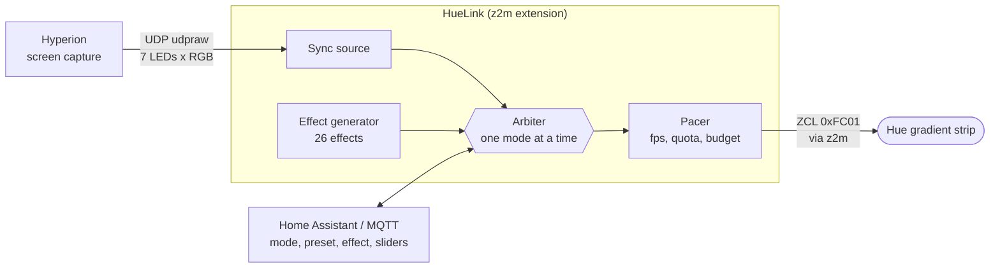
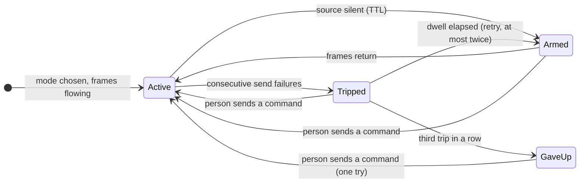

# HueLink

Drives a Philips Hue gradient lightstrip from **zigbee2mqtt alone**, using the strip's own Entertainment streaming mode. Hyperion screen colours reach the strip at full gradient resolution with **no Hue bridge, no Hue account, no cloud and no bridge emulator**. 26 local effects travel the same path.

HueLink is a zigbee2mqtt external extension: no new container or service, it runs inside the z2m process you already have.



Exactly one **mode** is active: **Light** (plain Zigbee light, no streaming), **Effect** (local generator) or **Sync** (Hyperion). The arbiter is the only place that decides which.

---

## Requirements

| Need | Details |
|---|---|
| zigbee2mqtt **2.1.1+** | 2.0 added auto-loaded `external_extensions/` and `external_converters/`; frames go out via `endpoint.zclCommand`, which needs `zigbee-herdsman-converters` 23+ (shipped in 2.1.1). Developed on 2.14.3. |
| Node 20+ | Whatever your z2m image already uses. |
| Strip paired **directly** to z2m | Not to a Hue bridge, or HueLink cannot see it. |
| Model **LCX002** | Hue Play gradient lightstrip, 7 segments, verified byte for byte. Other models: set `segments` and probably adjust `GRADIENT_LCX002` in `extension/huelink-lib/huepack.mjs`. |
| Hyperion | Only for Sync; effects work without it. Tested with Hyperion only, but any sender of raw UDP RGB frames (3 bytes per LED, no header) should work. |
| Home Assistant | Optional. With `homeassistant:` enabled in z2m, HueLink publishes its own entities; otherwise use MQTT. |

---

## Install

Copy into the z2m **data directory** (the one with `configuration.yaml`: the `/app/data` bind mount in Docker, `/config/zigbee2mqtt` for the HA add-on, `data/` for bare installs).

```sh
Z2M_DATA=/path/to/zigbee2mqtt/data
mkdir -p "$Z2M_DATA/external_extensions" "$Z2M_DATA/external_converters"

cp -r extension/huelink.mjs extension/huelink-lib "$Z2M_DATA/external_extensions/"   # extension + effects
cp converter/huelink-exposes.mjs "$Z2M_DATA/external_converters/"            # huelink_* fields on the device page
cp huelink.config.example.json "$Z2M_DATA/huelink.config.json"               # settings
```

```
<z2m data>/
  configuration.yaml
  huelink.config.json
  external_extensions/   huelink.mjs, huelink-lib/...
  external_converters/   huelink-exposes.mjs
```

Edit `huelink.config.json`: set **`device`** to your strip's `friendly_name` (required) and make `udpPort` match Hyperion. Then **restart z2m** (a restart, not "save extension": see [Versioning](#versioning)).

A healthy start logs, in order: settings read, effects loaded, startup reset sent, then
`[huelink] v<version> listening on UDP 19447, 5 fps -> <your strip>`.

- `no settings file...`: the config is not where the extension looks.
- `device '<name>' not found...`: `device` does not match a real `friendly_name`.
- A bad config value is an `ERROR` naming the field; only that field falls back to its default.

---

## What appears where

**zigbee2mqtt device page** (the converter's job): fifteen `huelink_*` fields after the normal light controls. All writable ones are **live**; the config file only sets their starting value.

| Field | Meaning |
|---|---|
| `version`, `status`, `fps_real`, `dropped` | Read-only: loaded version, one-line state, frames delivered in the last 5 s, frames suppressed since start |
| `mode` | Light / Effect / Sync |
| `preset` | Normal / Movies / Sports / Games / Music / Vivid; shows no value once any slider is moved |
| `fps`, `delta`, `duty`, `budget` | Frame cap, delta threshold, quota per 100 ms, air budget % |
| `smoothing`, `cut_threshold`, `cut_ms`, `cut_per_sec` | Fade length, scene-cut size, scene-cut fade, cuts per second |
| `saturation` | Colour saturation % |

**Home Assistant** gets a separate "HueLink" device, linked to the strip with `via_device`:

| Group | Entities |
|---|---|
| Main | Mode, Picture preset, Effect, Effect speed, Status |
| Configuration | Frame cap, Air budget, Fade length, Scene cut threshold / fade / per second, Colour saturation, Effect brightness |
| Diagnostic | Frames per second, Coordinator load, Deliverable frame rate, Strip needs attention |

- Status is a main control: it is the only way to tell a strip that is dark on purpose from one that stopped answering.
- Power is the strip's own `light` entity. There is no HueLink power switch.
- **Upgrading: reload the MQTT integration once** (Settings > Devices & services > MQTT > Reload). HA reads `entity_category` only when it registers an entity.
- On a brand-new install `via_device` may be skipped until the next discovery (a z2m restart).
- **Duplicates:** z2m also publishes the `huelink_*` fields next to the light in HA. They are discovered *disabled*, which does nothing for entities HA already registered: disable or delete those once in HA.

---

## Configuration

Every field is optional. **Live** fields apply when you save the file (mtime checked every 2 s). Fields with a Home Assistant slider (budget, picture quality, saturation) are **starting values only**, so a save never undoes a preset or slider; they and the **restart** fields are named in the log when the file changed, not silently ignored.

```
config changed, applied: fastSmoothingMs=30, burstFps=12
config changed: segments, udpPort only take effect after a zigbee2mqtt restart
```

### Basics

| Field | Default | Notes |
|---|---|---|
| `device` | `"Hue Gradient Strip"` | Strip `friendly_name`. Also the power switch. **Must set.** |
| `segments` | `7` | LCX002 has 7. Does not teach a different pixel map. |
| `udpPort` | `19447` | Where Hyperion's `udpraw` points. |
| `udpBind` | `"0.0.0.0"` | `"127.0.0.1"` if Hyperion is on the same host. |
| `udpAllowFrom` | `[]` | Allowed sender IPs. Empty = anyone who reaches the port (a frame has no sender or password). Drops are summarised once a minute, never per sender, so a forged source cannot flood the log. |
| `tickMs` | `20` (1-1000, restart) | Loop period, **not** the frame rate. Short so a cut is noticed immediately. |
| `startSettleMs` | `2000` (restart) | Startup pause so echoes from the previous run can finish. |
| `sourceTtlMs` | `1000` | Silence after which a source counts as gone and the strip turns off (`udpraw` has no end-of-stream signal). |
| `name` | `"huelink"` | MQTT topic `<base>/<name>`, commands on `<base>/<name>/command` (not `/set`, see docs/DESIGN.md). |
| `locale` | `"en"` | `"en"` or `"lv"`. Wire values (MQTT keys, modes, effect ids) are never translated. Mode names are HA select values, so changing it renames them. Preset names are fixed English. |

### Pacing

How much of the Zigbee coordinator the strip may take from the rest of the house. Read [docs/PACING.md](docs/PACING.md) before raising any of these.

| Field | Default | Notes |
|---|---|---|
| `fps` | `5` (1..`maxFps`, restart) | **Starting** value only; HA and the device page own it afterwards. 5 is not a radio limit, see PACING.md. |
| `maxFps` | `5` (1-50, restart) | Highest cap the slider accepts. Permission, not delivery; raising it alone changes nothing. |
| `dutyCap` | `2` (1-5, restart) | Frames per 100 ms window. Bounds how many frames can sit ahead of a wall-switch press. 2 = 20 fps ceiling. |
| `occupancyBudget` | `0.35` (0.05-0.9, starting value) | Share of wall time streaming may keep the coordinator busy. Buys roughly budget / frame cost: 0.35 at 51 ms = 6.9 fps. Above ~0.4 the house queues behind the strip. HA shows 5-90 %. |

### Picture quality

Starting values (the sliders own them while running). These change the look, not the air used.

| Field | Default | Notes |
|---|---|---|
| `smoothingFactor` | `1.15` (1-2) | Fade time as a multiple of the frame gap. Above 1 so colour never rests between frames. Higher = smoother, further behind. |
| `bigChangeThreshold` | `6` (1-40) | Perceptual steps that count as a scene cut. 1 = everything is a cut and `fps` controls nothing; 40 = off. |
| `fastSmoothingMs` | `50` (0-500) | Fade for a scene cut. 20-40 is worth trying. |
| `maxFastPerSec` | `1` (0-10) | Scene cuts per second that may skip the frame clock. A ration, so a strobe cannot make `fps` meaningless. 0 = off. |
| `saturation` | `1.0` (0.5-2) | Multiplier, `c' = luma + (c - luma) * s` on sRGB bytes (Rec.709). 1.0 is bit-identical to no saturation. Grey and black stay put; brightness is untouched. Try 1.3-1.6; above ~1.8 content clips to primaries. **Costs the coordinator nothing.** HA shows 50-200 %. |

### Presets

> **Warning:** the air budget, the presets and the sliders are reachable by anything that can publish to `huelink/command` or use the HA device. Raising the budget (Games, Sports, Music or by hand) takes coordinator time from every other Zigbee device. Change them **at your own risk** and watch the Zigbee network (command latency, failures, offline devices) closely while you do.

`huelink_preset` sets all seven picture knobs (`fps`, `occupancyBudget`, the four above, `saturation`) at once. Moving any slider afterwards clears the selection (the select shows no value).

| Preset | What it is |
|---|---|
| **Normal** | The defaults, and the way back. |
| **Movies** | Calm and **cheaper** than Normal: 4 fps, longer fade. |
| **Sports** | Fast motion without flicker: **higher** cut threshold so camera flashes and LED boards are not scene cuts. |
| **Games** | Lowest latency: barely any fade, 4 cuts/s. Costliest. |
| **Music** | Flashes over frame rate: slow stream, 5 cuts/s. |
| **Vivid** | Saturation 1.55, pacing untouched, costs nothing. |

- A preset cannot exceed `maxFps`. On a default install Games (8) and Sports (7) land at 5, and the log names every knob that was trimmed.
- Games and Sports raise `occupancyBudget` (0.55 / 0.50) because 8 fps at 51 ms does not fit in 0.35. Presets never touch `dutyCap`, so the worst wait for someone else's command stays two frames.
- Presets are **data** in `extension/huelink-lib/presets.json` (edit + restart). A malformed entry is logged and skipped. Arguments for each number live there; arithmetic in [docs/PACING.md](docs/PACING.md).

### Tuning fast content

Defaults suit film. For strobes, music videos or games, turn these **one at a time, in this order**:

1. **Scene cuts per second 1 -> 4.** At 1, a strobe at 10 Hz gets one flash; the rest are averaged away. Nothing else matters until this moves.
2. **Scene cut fade 50 -> 20 ms.** Flashes land as flashes. Below ~15 ms some strips click.
3. **Scene cut threshold 6 -> 3**, only if still sluggish. Below ~3 nearly everything is a cut and the frame cap stops controlling the rate.

A reasonable set: 4 cuts/s, 20 ms, threshold 4. Slow fades still lagging? Lower **Fade length** towards 1.05 or raise the frame cap.

### Going above 5 fps

The frame cap is permission, not delivery. Two limits bind, both plain division:

- **Quota:** `dutyCap` frames per 100 ms. Default 2 = 20 fps; 25 needs 3.
- **Budget:** `occupancyBudget` / frame cost. At 51 ms, 0.35 buys **6.9 fps**; even 0.9 only reaches 17.6.

On a shared coordinator 25 fps is not payable, and HueLink says so once, when the answer changes (also published as `fpsCeiling`):

```
frame cap asked for 25 fps, 6.9 is what can be paid for: the frame quota allows 20
and the air budget allows 6.9 at 51 ms a frame. ...
```

### Separate coordinator

The 5 fps default comes from one measurement: a frame costs a shared coordinator ~51 ms, and the strip may use only a third of it. **On a shared coordinator, raising these makes the rest of the house slower. Leave this section alone.** On a coordinator dedicated to the strip the defaults leave capacity unused.

1. **Measure:** run Sync for a minute, read `pacer.avgSendMs` from `mosquitto_sub -t zigbee2mqtt/huelink -C 1`. That is your price.
2. **Arithmetic:**
   ```
   budget fps = occupancyBudget / (avgSendMs / 1000)
   duty fps   = dutyCap * 10
   maxFps     = min(budget fps, duty fps)
   ```
3. **Raise in this order:** `occupancyBudget` first (0.7 is defensible on a dedicated stick; set it with the slider), `dutyCap` only if the budget now exceeds `dutyCap * 10` fps, `maxFps` last. Restart z2m, then raise `fps`.
4. **Verify:** `fps_real` is close to `fps`; `pacer.skippedDuty` is not climbing; `pacer.worstSendMs` is not growing (the tail is what ends in `SRSP - AF - dataRequest after 6000ms`). Then switch a light that is *not* the strip by hand: it must still feel immediate.

If the numbers disagree, the log warns at startup rather than quietly trimming. No frame rate is promised.

### Burst

Off by default. A burst spends the budget **earlier**; it creates none. It pays only from credit that quiet scenes bank, so the long-term average stays `occupancyBudget`. Read [docs/PACING.md](docs/PACING.md) first. All live.

| Field | Default | Notes |
|---|---|---|
| `burstFps` | `0` (off, 0-15 or `maxFps`) | Frame rate during a burst, started by a scene cut. Does not touch `dutyCap`. |
| `burstMaxMs` | `1000` (0-5000) | Longest single burst. 0 also disables. |
| `burstCreditMs` | `500` (0-5000) | Bucket size in coordinator ms; the real limiter. |
| `burstRefill` | `1` (0-1) | Share of unspent budget banked as credit. |

Measured (300 s synthetic film, 51 ms frames): burst at 12 fps moved mean occupancy 19.5 -> 21.6 % and p95 20.4 -> 30.6 %, while the worst wait for a foreign command stayed one frame (51 ms). See `tools/burstbench.mjs`.

---

## Connecting Hyperion

**1. LED layout: exactly `segments` LEDs** (7 for LCX002), under *LED Hardware -> LED Layout*. The datagram is a flat list mapped by position: bytes 0-2 -> segment 1, 3-5 -> segment 2, ... 18-20 -> segment 7. LED #1 is the end of the strip you call first. If the gradient runs backwards, reverse the order in Hyperion, not here.

**2. Output device** (*LED Hardware -> LED Controller*):

- Type **`udpraw`**, RGB byte order
- Target: the machine running **zigbee2mqtt** (not HA, not the coordinator)
- Port: `udpPort` (default 19447)

`udpraw` is plain gamma-encoded sRGB, 3 bytes per LED, no header (21 bytes for 7). `udpddp` also works (the 10-byte header is stripped) but adds a parser for nothing at 7 LEDs. Hyperion applies its own colour correction before output, so wire bytes differ from a test pattern.

**The port is unauthenticated by design** (that is what makes `udpraw` cheap): anything that reaches it can drive the strip. On a home LAN the worst case is a prank. To close it, set `udpAllowFrom` to your Hyperion host, or `udpBind` to `127.0.0.1` if it is local.

**Docker: publish the UDP port.** The most common reason Sync never starts.

```yaml
    ports:
      - "19447:19447/udp"
```

**3. Check frames arrive:** set Mode to Sync, play something, watch `huelink_fps_real` (above 0 = working). If it stays 0, on the z2m host run `python3 tools/udpdump.py 19447 5` and look for `length=21` (stop the extension first; only one process can bind the port).

**4. Automatic capture on/off.** Hyperion's output does not know whether anyone listens, and Sync does not know whether the TV is on. Use one automation that enables capture only when HueLink Mode is `Sync` **and** the TV is on. HueLink deliberately does not read TV state (a second source of truth). When capture stops, frames stop, the TTL expires, the strip turns off and goes **armed**; when frames return it relights with no command.

---

## Effects

26 effects in three groups (Holiday, Mood, Party) in one `select`. There is no "None": no effect is a mode.

The strip is a bias light behind a TV, so every effect must be visible within two seconds and must not sit near-black (two, a wake-up ramp and a wind-down, are dark on purpose and say so). `tools/effectproof.mjs` measures this on the bytes sent.

Effects are **data**: add an entry to `extension/huelink-lib/effects/effects.json` (and a generator file only for a genuinely new motion). See [docs/EFFECTS.md](docs/EFFECTS.md).

---

## How the strip's state works



- **Armed:** the source went quiet but your choice stands; the strip is off and relights when frames come back. Nothing is wrong.
- **Tripped:** the strip stopped answering and the circuit breaker opened (a failed frame can hold the coordinator for up to 6 s, so a few in a row stall the whole network). After a dwell (5 min, then 10 min) HueLink retries by re-**arming**, not relighting. After the third trip in a row (two automatic retries) it stops retrying and waits for you: turn the strip on or pick a mode. The "Strip needs attention" binary sensor turns on then, for an HA notification, and stays on until the strip proves it is back: it confirms a power on, or takes frames again. The breaker is not persisted: a zigbee2mqtt restart clears the sensor and starts the retries over.

---

## Troubleshooting

| Symptom | Cause / fix |
|---|---|
| No `huelink_*` fields on the device page | Converter not loaded. `huelink-exposes.mjs` must be in `external_converters/` with `external_extensions/huelink-lib/` beside it in the same data directory. Look for `huelink-exposes` in the log; a failed load renames it `.invalid` (light control keeps working). |
| Strip ignores everything, no `[huelink]` log lines | Extension did not start: files not in `external_extensions/`, or `device` does not match a `friendly_name`. |
| Mode is Sync, nothing happens | Sync with no frames is `off` by design. Check: Hyperion capture running; controller is `udpraw` to the z2m host and right port; UDP port published in Docker; `tools/udpdump.py` sees 21-byte datagrams. |
| Dark and unsure why | Read `huelink_status`. **armed** = waiting for frames, normal. **tripped** (`"<mode> stopped: the strip is not responding"`) = breaker open; it retries itself, or pick a mode / turn power on to retry now. If the status adds "auto-retry gave up", it no longer retries: turn power on or pick a mode. |
| Sync freezes, then catches up; log says `the picture reached the strip N ms late` | Each line names where the time went (frame in flight, pause after a failed frame, air budget, frame quota). The `frame send failed` line just before it carries the real error. See [docs/PACING.md](docs/PACING.md), "Latency spikes and the occupancy meter". |
| `fps_real` below `fps` | Normal: the pacer trims frames by budget and delta suppression. High `dropped` + low `fps_real` = suppression working; low `dropped` + low `fps_real` = sends are failing. See [docs/PACING.md](docs/PACING.md). |
| Edited a file under `huelink-lib/`, nothing changed | z2m reloads only the top-level file; `huelink-lib/` stays cached until a process restart. Confirm with `huelink_version`. |
| Light off button does nothing mid-stream | Should not happen (HueLink intercepts power on the strip's `/set`). The extension is not running. |

---

## Deploying

`scripts/deploy.sh` repeats the install: copies `extension/` and the converter, makes z2m load them, waits until the live extension confirms the new code, then publishes `sensor.huelink_deployed_version` to Home Assistant and reads it back.

Copy `.env.example` to `.env` (needs `HA_URL`, `HA_TOKEN`, `Z2M_EXTENSIONS_DIR`, `MQTT_HOST` and broker credentials). Precedence: environment variable, then `.env.deploy` (optional, for one run elsewhere), then `.env`. A key set in both files is named on stderr with the winner. Both files are gitignored.

```sh
scripts/deploy.sh --dry-run       # print every step, change nothing
scripts/deploy.sh                 # copy, load, verify, publish version
scripts/deploy.sh --version-only  # publish the version sensor only
```

`--no-reload` copies only, `--force` allows uncommitted changes, `-h` lists the rest. Needs `mosquitto_pub` and `mosquitto_sub`.

- **Secrets never reach a command line:** the HA token goes to `curl` and broker credentials to mosquitto via `0600` files in the run's temp dir. A broker password with whitespace is refused (the defaults file cannot quote it).
- **Set `Z2M_RESTART_CMD`** (e.g. `docker restart zigbee2mqtt`), or `huelink-lib/` changes will not go live: hot reload re-imports only the top-level file, and `bridge/request/restart` restarts inside the same process. With it set, success requires the retained state to report the new version **and** a process start later than the copy. Without it the script falls back to hot reload and says `huelink-lib/` is still old.
- An entity created via the HA REST API is not persistent: HA forgets it on restart until the next deploy. Fine for a marker; do not build automations on it.

---

## Versioning

`VERSION` in `extension/huelink.mjs` and `version` in `package.json` must be bumped together in the same commit. Because z2m's reload leaves `huelink-lib/` cached, `huelink_version` on the device page is how you tell which code is really running.

---

## Documentation

- [docs/DESIGN.md](docs/DESIGN.md): arbiter and two-controls model, armed vs tripped, restart behaviour, full MQTT surface, how the converter extends the Philips definition.
- [docs/PROTOCOL.md](docs/PROTOCOL.md): Entertainment format over Zigbee (cluster `0xFC01`), xy quantisation, stream lifecycle, LCX002 profile, byte-for-byte comparison with Bifrost.
- [docs/PACING.md](docs/PACING.md): why 5 fps and not 25; delta threshold, duty cap, budget, scene-cut fast path, bench numbers.
- [docs/EFFECTS.md](docs/EFFECTS.md): effect catalogue format, palettes, generators, adding an effect without JavaScript.
- [docs/TESTING.md](docs/TESTING.md): what each test pins down; none needs a bridge or a strip.
- [docs/TOOLS.md](docs/TOOLS.md): the bench scripts behind the quoted numbers.

---

## Credits

**[Bifrost](https://github.com/chrivers/bifrost)** (chrivers) is the reference for the Entertainment protocol: the byte layout, wide-gamut xy quantisation and LCX002 profile were read from it, and HueLink's output matches it byte for byte on 4 of 4 test cases ([docs/PROTOCOL.md](docs/PROTOCOL.md)). HueLink is an independent, much smaller implementation: Bifrost emulates a whole Hue bridge (~27k lines of Rust), whereas z2m already owns the Zigbee link, so only the ~55-byte frame format was missing.

Also **[zigbee2mqtt](https://github.com/Koenkk/zigbee2mqtt)** and `zigbee-herdsman-converters` (all the Zigbee work) and **[Hyperion](https://github.com/hyperion-project/hyperion.ng)** (the frames).

## License

MIT, © gatisr. See [LICENSE](LICENSE).
